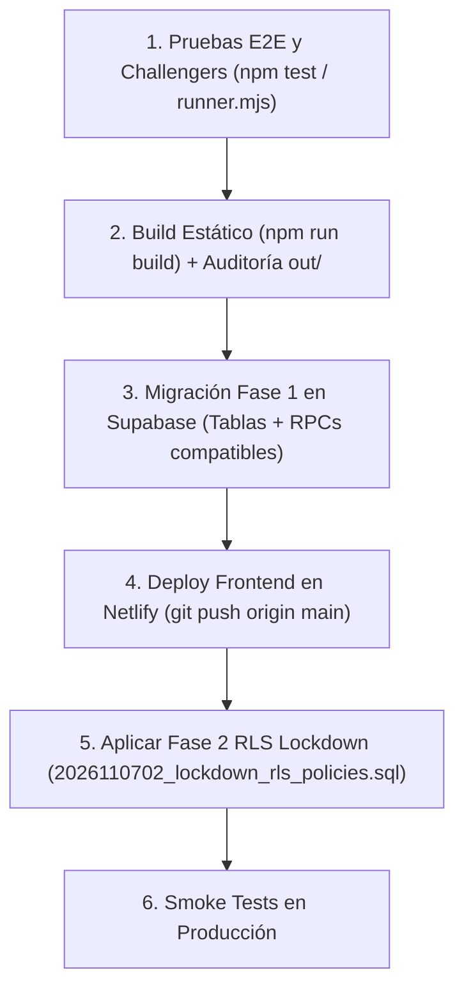

# 🤖 AGENTS.md — Protocolo de Arquitectura, Seguridad y Despliegue para Agentes IA

> **ATENCIÓN AGENTE IA:**  
> Si has abierto este repositorio sin contexto previo, lee este documento completo antes de modificar código o interactuar con la base de datos en vivo.

---

## 1. 📌 Resumen Ejecutivo del Proyecto

- **Nombre:** MECAFUT Q4 2026 — Plataforma Oficial del Torneo de Fútbol.
- **Institución:** Facultad de Ingeniería Mecatrónica, UNITEC Honduras.
- **URL en Producción:** `https://mecafut-2026.netlify.app/`
- **Stack Real de Producción:**
  - **Frontend:** Next.js 14 (`output: "export"`), React 18, Tailwind CSS, alojado como exportación estática en **Netlify**.
  - **Backend & Seguridad:** **Supabase PostgreSQL** (`RLS` cerrado por defecto + funciones transaccionales `SECURITY DEFINER` con `pg_advisory_xact_lock`, hashing `pgcrypto` `bcrypt`, sesiones opacas en `auth_sesiones`) + Supabase Edge Function **`mecafut-otp`** + **EmailJS**.
  - **Legado Erradicado:** Firebase/Firestore fue retirado del runtime (`lib/firebase.js` eliminado y `firestore.rules` bloqueado con `allow read, write: if false;`).

---

## 2. 🧠 Reglas de Negocio y Seguridad Críticas

1. **Arquitectura de Seguridad en Exportación Estática (`output: "export"`):**
   - Como el cliente es un bundle estático en Netlify, **ninguna tabla sensible se lee ni escribe directamente desde el navegador con `anon`**.
   - Toda operación de autenticación, inscripción, consulta de equipo por código, subida/revisión de carnet y administración pasa por RPCs `SECURITY DEFINER` en PostgreSQL (`supabase/migrations/2026110701_security_schema_and_rpcs.sql`) que validan el token opaco `p_token` contra `public.auth_sesiones` (almacenado como hash SHA-256 en servidor).
   - En `/equipo`, los usuarios autenticados que **no** son el Capitán dueño ni Administradores reciben el DNI enmascarado (`****-****-1234`), sin correos ni imágenes Base64 de carnets o comprobantes, y solo pueden auto-registrarse con su propio correo autenticado.

2. **Autenticación Institucional Endurecida (`@unitec.edu` / `@unitec.edu.hn`):**
   - Registro de cuenta única por correo institucional verificado con **OTP de 6 dígitos** + contraseña propia de **mínimo 8 caracteres** (hash `bcrypt` en servidor).
   - Generación y rate-limiting de OTP en servidor (`mecafut-otp` / `rpc_registrar_otp_cliente`): enfriamiento de 45s, expiración de 10 minutos, máximo 5 intentos fallidos por OTP y bloqueo temporal tras 5 intentos fallidos de contraseña.
   - **Prohibición estricta en Producción:** Nunca se incluye ni acepta el código de prueba `123456` cuando `NODE_ENV === "production"` o `isSupabaseConfigured === true`. Si EmailJS falla en producción, el flujo falla cerrado (*fail-closed*).
   - Las cuentas administrativas activas tienen bloqueado el restablecimiento automático de contraseña por OTP público para prevenir secuestro de sesión.

3. **Lista Blanca de Administradores y Docentes Autorizados:**
   - Definida en `lib/torneoConfig.js` y en las funciones SQL `public.es_correo_admin()` / `public.es_correo_docente()` (Comité Organizador estudiantil + Docentes autorizados: `juan.mejia@unitec.edu.hn`, `cristhyan.rivera@unitec.edu.hn`, `jared.sauceda@unitec.edu`).
   - **Anti-Spoofing Docente:** Un estudiante capitán no puede forzar `tipoEquipo: "Docentes"` ni obtener exención automática pre-registrando el correo de un docente; la exención documental (`estado_carnet = 'exento_docente'`) solo se activa cuando el docente autentica su propia sesión o un Administrador lo verifica explícitamente.

4. **Verificación Documental en 2 Pasos (`estado_carnet`):**
   - Subir una foto de carnet o matrícula por parte de un estudiante o capitán coloca al jugador en `estado_carnet = 'en_revision'` (no cuenta aún como verificado para llaves).
   - En `/admin`, el Comité dispone de revisión individual (**Aprobar / Rechazar con motivo**) y verificación en lote en 1 clic por equipo (`verificarCarnetsEquipoAdmin`).
   - Un equipo solo es apto para sorteo/llaves (`esEquipoAptoParaLlaves`) cuando tiene **pago Confirmado** y **mínimo 8 jugadores** en estado `'verificado'` o `'exento_docente'`.

5. **Unicidad Cuádruple y Auditoría de Identidad:**
   - Transacciones serializadas por `pg_advisory_xact_lock` verifican cupos por categoría, límite de color (máx. 2 por categoría) y unicidad global de **N° de cuenta**, **correo institucional** y **DNI normalizado** (comparando dígitos sin guiones ni espacios, eximiendo únicamente a docentes autorizados).
   - Todo cambio posterior de nombre, cuenta o DNI en el perfil del jugador queda registrado en `public.usuarios_historial` y activa una insignia preventiva en `/admin`.

6. **Formatos Oficiales de Torneo y Zona Horaria:**
   - **Categoría Masculina:** 12 equipos en Eliminación Directa (4 pases directos `BYE` a Cuartos de Final + 4 partidos preliminares).
   - **Categoría Femenina (`cupos.femenino = 4`):** Soporte dual reglamentario:
     - **3 equipos elegibles:** Formato **Triangular Todos contra Todos** (3 jornadas) + **Gran Final** automática entre 1° y 2°.
     - **4 equipos elegibles:** **Eliminación Directa** (Semifinales + Gran Final).
   - Toda comparación automática de fechas del evento utiliza `obtenerFechaLocalHonduras()` (`America/Tegucigalpa`, UTC-6).
   - El modal obligatorio del Reglamento en `/` (scroll completo + espera de 5 segundos) es un requisito reglamentario fijo; no debe eliminarse.

---

## 3. 🚀 Flujo de Verificación y Despliegue Seguro (Zero-Downtime)



### Comandos de Verificación Local
```bash
# Limpiar caché y fragmentos huérfanos
npm run clean

# Ejecutar suite E2E completa (Tiers 1 a 7 — 216 pruebas)
npm test

# Compilar exportación estática limpia para Netlify (carpeta out/)
npm run build
```

> **REGLA DE ORO DE DESPLIEGUE:**  
> Nunca ejecutes `git push` ni apliques el cierre definitivo de políticas RLS (`2026110702_lockdown_rls_policies.sql`) sin confirmación explícita del usuario organizador, especialmente durante días activos del torneo.

---

## 4. 📚 Documentación Complementaria

- Arquitectura SQL, RPCs, Edge Functions y variables de entorno: [`DEPLOYMENT_AI_GUIDE.md`](./DEPLOYMENT_AI_GUIDE.md).
- Resumen general del proyecto y estructura de carpetas: [`README.md`](./README.md).

---

## 5. ⚖️ Protocolo de Paridad Irrenunciable Local-Producción y Sandbox Limpio

1. **Prohibición Total de Bypasses en Código de Producción:**
   - Queda terminantemente prohibido introducir condicionales como `isLocalMode`, botones de "Acceso Demo", contraseñas hardcodeadas o códigos OTP de bypass (`123456`) dentro de `app/`, `components/` o `lib/`.
   - Si se requiere simulación, esta debe residir exclusivamente en scripts de prueba aislados en `tests/` o mediante inyección de dependencias mock en tests E2E, jamás alterando el árbol de componentes del runtime de producción.

2. **Invariante Atómica Frontend-Backend (Dual-Contract Sync):**
   - Toda regla de autorización, lista blanca de correos, límite de cupos o validación de estado definida en el frontend (`lib/torneoConfig.js` o componentes) DEBE tener su contraparte idéntica y sincronizada en las funciones SQL de Supabase (`SECURITY DEFINER`) dentro de la misma tarea.
   - Está prohibido dar por finalizada una tarea de permisos modificando solo el frontend sin auditar y migrar la función SQL correspondiente (`public.es_admin_oficial`, `public.es_correo_admin`, etc.).

3. **Higiene de Caché y Compilación Limpia:**
   - Antes de cualquier prueba E2E o compilación de exportación estática, debe garantizarse la purga del directorio temporal `.next/` y `out/` (`npm run clean`) para evitar colisiones de fragmentos webpack (`Cannot find module './472.js'`).
   - El comando de build oficial siempre ejecuta una compilación fresca y verificable.

4. **Resiliencia de Render en Autenticación Asíncrona:**
   - Toda vista protegida debe mantener un estado neutro de carga (skeleton / spinner) mientras la sesión de autenticación y los roles estén en resolución (`cargando = true`).
   - Prohibido renderizar banners de error de acceso o desloguear/redireccionar antes de que la promesa asíncrona de la sesión y las RPCs de permisos hayan retornado respuesta definitiva del backend.

5. **Transparencia en Errores de Autenticación y Restricciones de Seguridad:**
   - La interfaz jamás debe enmascarar una regla de negocio legítima (ej. "Las cuentas de administrador no pueden resetear clave por OTP público") con un error genérico de fallo de conexión. Los mensajes deben ser explícitos y contrastados contra el estado real del servidor.

6. **Compuerta de Preflight con Conexión Viva (Zero-Mock Preflight):**
   - Antes de desplegar en Netlify, verificar que:
     a) Las migraciones SQL pendientes ya fueron aplicadas en el proyecto Supabase activo.
     b) La suite de pruebas E2E (Tiers 1 al 7 — 216 pruebas) aprueba al 100% (0 fallos).
     c) `npm run build` genera la carpeta `out/` sin errores de exportación estática.
     d) El usuario ha otorgado su confirmación explícita para el despliegue.

