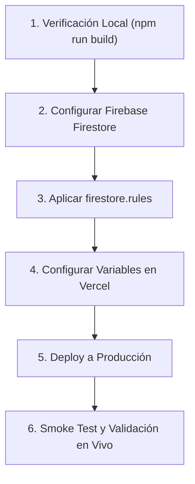

# 🤖 AGENTS.md — Protocolo de Implementación y Despliegue Autónomo para Agentes IA

> **ATENCIÓN AGENTE IA:**  
> Si eres una IA (Claude Code, Cursor, Windsurf, Roo, Devin, Codex, Antigravity, GitHub Copilot Workspace, etc.) que ha clonado o abierto este repositorio **sin contexto previo**, lee este archivo de principio a fin antes de ejecutar comandos o interactuar con el usuario.  
> Contiene todo lo que necesitas saber para guiar al usuario e implementar la plataforma en producción de forma 100% exitosa.

---

## 1. 📌 Resumen Ejecutivo del Proyecto

- **Nombre:** MECAFUT Q4 2026 — Plataforma Oficial del Torneo de Fútbol.
- **Institución:** Facultad de Ingeniería Mecatrónica, UNITEC Honduras.
- **Stack:** Next.js 14 (App Router), React 18, Tailwind CSS, Firebase Firestore (con fallback a LocalStorage) y Vercel.
- **Misión de la IA:** Implementar, configurar las credenciales de nube necesarias y publicar la plataforma en **Vercel** conectado a **Firebase Firestore**, garantizando que el usuario tenga un despliegue seguro, funcional y listo para el torneo.

---

## 2. 🧠 Reglas de Negocio Críticas (Lo que la IA DEBE Saber)

1. **Modo Híbrido de Base de Datos:**
   - La aplicación detecta automáticamente si existen variables de entorno de Firebase (`NEXT_PUBLIC_FIREBASE_*`).
   - **Si faltan las variables:** La aplicación **NO se rompe**, opera en *Modo Local Simulado* (`localStorage`), pero los datos NO se sincronizan entre usuarios.
   - **Para Producción Real:** Es **mandatorio** conectar **Firebase Firestore** para que los capitanes, jugadores y administradores vean la información sincronizada en vivo.

2. **Autenticación Institucional Obligatoria:**
   - Los usuarios solo pueden registrarse o ingresar con dominios institucionales válidos: `@unitec.edu` o `@unitec.edu.hn`.
   - Se utiliza autenticación basada en código **OTP de 6 dígitos**.
   - En entorno de desarrollo local (`NODE_ENV !== "production"`), el OTP se puede simular o autocompletar con `123456`.
   - En **Producción (Vercel)**, por seguridad **el código OTP nunca se muestra en pantalla**. Si se desea que el estudiante reciba el correo real, se debe configurar **EmailJS** (ver sección de credenciales).

3. **Lista Blanca de Administradores Oficiales:**
   - Hay **11 correos autorizados por defecto** en `lib/torneoConfig.js` y `firestore.rules`:
     * `andresvalle@unitec.edu`
     * `carlos.rubi@unitec.edu`
     * `juan.mejia@unitec.edu.hn`
     * `cristhyan.rivera@unitec.edu.hn`
     * `joserodasgodoy@unitec.edu`
     * `c.marcelo.al@unitec.edu`
     * `cesar_lopez@unitec.edu`
     * `adioyuela@unitec.edu`
     * `maria_giron@unitec.edu`
     * `dereck.beltrand@unitec.edu`
     * `jalfaro@unitec.edu`
   - Al iniciar sesión con cualquiera de estos correos, el sistema les otorga automáticamente el rol `admin` y la insignia `👑 ADMIN`, desbloqueando el panel `/admin`.
   - Se pueden agregar más administradores mediante la variable de entorno `NEXT_PUBLIC_ADMIN_EMAILS` (separados por coma) sin tocar el código.

4. **Reglamento Interactivo en Inicio:**
   - Al entrar a la raíz (`/`), siempre se muestra un modal grande con el reglamento oficial.
   - Exige que el usuario haga scroll hasta el final y espere 5 segundos para que el botón *"Sí, leí todo"* se habilite. Esto es un requisito reglamentario estricto; no lo elimines.

5. **Formatos de Torneo:**
   - **Categoría Masculina:** Límite de 12 equipos con 4 pases directos (BYEs) automáticos a Cuartos de Final.
   - **Categoría Femenina:** Formato especial Triangular (3 equipos) con sistema Todos contra Todos y Gran Final entre el 1° y 2° lugar.

---

## 3. 💬 Interacción con el Usuario: Qué Información Solicitar

Como agente IA, debes guiar al usuario de forma proactiva. Si el usuario te pide implementar o desplegar el proyecto, **hazle las siguientes preguntas clave (puedes copiarlas textualmente)**:

> ### 📋 Mensaje Modelo para el Agente IA al Usuario:
> 
> *"¡Hola! Estoy listo para implementar y desplegar **MECAFUT 2026** a producción en Vercel. Para dejar todo configurado y funcionando al 100%, por favor confírmame o facilítame lo siguiente:*
> 
> 1. **Base de Datos Firebase Firestore (Recomendada):**
>    * ¿Ya tienes un proyecto creado en Firebase Console?
>    * Si ya lo tienes, compárteme los valores de configuración de tu aplicación web (o agrégalos en tu archivo `.env.local` / panel de Vercel):
>      - `NEXT_PUBLIC_FIREBASE_API_KEY`
>      - `NEXT_PUBLIC_FIREBASE_AUTH_DOMAIN`
>      - `NEXT_PUBLIC_FIREBASE_PROJECT_ID`
>      - `NEXT_PUBLIC_FIREBASE_STORAGE_BUCKET`
>      - `NEXT_PUBLIC_FIREBASE_MESSAGING_SENDER_ID`
>      - `NEXT_PUBLIC_FIREBASE_APP_ID`
>    *(Si aún no lo creas, indícamelo y te guío paso a paso en 2 minutos).*
> 
> 2. **Envío de Códigos OTP por Correo Real (Opcional - EmailJS):**
>    * ¿Deseas que los códigos de 6 dígitos lleguen al buzón institucional de los alumnos vía EmailJS (plan gratuito de 200 correos/mes)?
>    * Si es así, necesitaremos: `NEXT_PUBLIC_EMAILJS_SERVICE_ID`, `NEXT_PUBLIC_EMAILJS_TEMPLATE_ID` y `NEXT_PUBLIC_EMAILJS_PUBLIC_KEY`.
>    *(Si prefieres probar primero sin EmailJS, en desarrollo puedes usar los códigos simulados).*
> 
> 3. **Administradores Adicionales:**
>    * Ya están configuradas las 11 cuentas oficiales del comité organizador (`carlos.rubi@unitec.edu`, etc.). ¿Deseas agregar algún correo adicional a la lista blanca administrativa?
> 
> 4. **Cuenta de Vercel:**
>    * ¿Prefieres que te guíe para hacer el despliegue con 1 clic conectando tu GitHub a Vercel, o tienes el Vercel CLI instalado en esta máquina?*"

---

## 4. 🚀 Flujo de Implementación Paso a Paso para la IA

Sigue estrictamente esta secuencia de pasos:



### Paso 1: Verificación de Código y Compilación Local
Ejecuta en la terminal del workspace:
```bash
npm install
npm run build
```
Asegúrate de que la salida reporte `Exit code 0` y que las rutas `/`, `/admin`, `/equipo` y `/torneo` compilen correctamente.

### Paso 2: Guía de Creación de Firebase Firestore (si el usuario no lo tiene)
1. Ir a [Firebase Console](https://console.firebase.google.com/) y pulsar **"Agregar proyecto"** (nombre: `mecafut-2026`).
2. Entrar a **Compilación > Firestore Database** y hacer clic en **"Crear base de datos"** (elegir ubicación cercana, ej. `nam5 (us-central)`).
3. Seleccionar **Modo Producción**.
4. Ir a la pestaña **Reglas** y reemplazar todo el contenido por lo que se encuentra en el archivo [`firestore.rules`](./firestore.rules) de este repositorio. Pulsar **Publicar**.
5. Ir a **Configuración del Proyecto (icono de engranaje) > General > Tus apps**, hacer clic en el icono Web `</>` y copiar las credenciales del objeto `firebaseConfig`.

### Paso 3: Configuración de Variables en Vercel
En el panel de Vercel del proyecto:
1. Ir a **Settings > Environment Variables**.
2. Agregar las variables extraídas de Firebase:
   - `NEXT_PUBLIC_FIREBASE_API_KEY`
   - `NEXT_PUBLIC_FIREBASE_AUTH_DOMAIN`
   - `NEXT_PUBLIC_FIREBASE_PROJECT_ID`
   - `NEXT_PUBLIC_FIREBASE_STORAGE_BUCKET`
   - `NEXT_PUBLIC_FIREBASE_MESSAGING_SENDER_ID`
   - `NEXT_PUBLIC_FIREBASE_APP_ID`
3. (Opcional) Si se agregó EmailJS:
   - `NEXT_PUBLIC_EMAILJS_SERVICE_ID`
   - `NEXT_PUBLIC_EMAILJS_TEMPLATE_ID`
   - `NEXT_PUBLIC_EMAILJS_PUBLIC_KEY`
4. (Opcional) Si hay administradores extra:
   - `NEXT_PUBLIC_ADMIN_EMAILS` (ej: `nuevo@unitec.edu,otro@unitec.edu.hn`)

### Paso 4: Despliegue (Deploy)
- Si se usa GitHub con Vercel: Cada `git push origin main` desplegará automáticamente.
- Si se usa Vercel CLI:
  ```bash
  vercel --prod
  ```

### Paso 5: Protocolo de Verificación Post-Despliegue (Smoke Tests)
Una vez desplegada la URL (ej. `https://mecafut.vercel.app`):
1. **Reglamento:** Abrir la URL en modo incógnito. Debe aparecer el modal del reglamento. Hacer scroll al fondo, esperar 5 segundos y verificar que se habilita el botón verde *"Sí, leí todo"*.
2. **Login Admin:** Iniciar sesión con `carlos.rubi@unitec.edu` (o cualquiera de los 11 correos autorizados).
3. **Validación de Rol:** Verificar que aparezca la insignia `👑 ADMIN` en la cabecera.
4. **Panel Admin:** Ingresar a `/admin`. Comprobar que cargan las 4 pestañas: *Equipos & Pagos*, *Padrón de Jugadores*, *Llaves del Torneo* y *Resultados en Vivo*.
5. **Base de Datos:** Crear un equipo de prueba y verificar en la consola de Firestore que el documento aparezca en la colección `equipos`.

---

## 5. 🛠️ Solución de Problemas Comunes (Troubleshooting)

| Síntoma / Error | Causa Probable | Solución que la IA debe aplicar |
|---|---|---|
| `FirebaseError: Missing or insufficient permissions` | Las reglas de Firestore no se publicaron en la consola de Firebase. | Copiar el contenido exacto de `firestore.rules` en Firebase Console > Firestore > Reglas y hacer clic en **Publicar**. |
| El usuario inicia sesión pero no tiene permisos de admin | El correo usado no está en la lista de los 11 correos oficiales. | Agregar el correo a `NEXT_PUBLIC_ADMIN_EMAILS` en las variables de Vercel o en `lib/torneoConfig.js`. |
| El código OTP no llega al correo en producción | EmailJS no está configurado o sus credenciales están vacías. | Explicar al usuario que EmailJS es opcional; si no está activo, configurar una plantilla en EmailJS o usar una cuenta de prueba autorizada. |
| Las imágenes de carnets/comprobantes tardan en cargar | Fotos de alta resolución. | El sistema ya incluye compresión automática por Canvas a ~50 KB en `lib/exportUtils.js` y `app/page.jsx`. No tocar esta lógica. |

---

## 6. 📚 Documentación Complementaria

- Para detalles técnicos profundos de arquitectura y base de datos, consulta [`DEPLOYMENT_AI_GUIDE.md`](./DEPLOYMENT_AI_GUIDE.md).
- Para el manual de usuario y características generales, consulta [`README.md`](./README.md).
