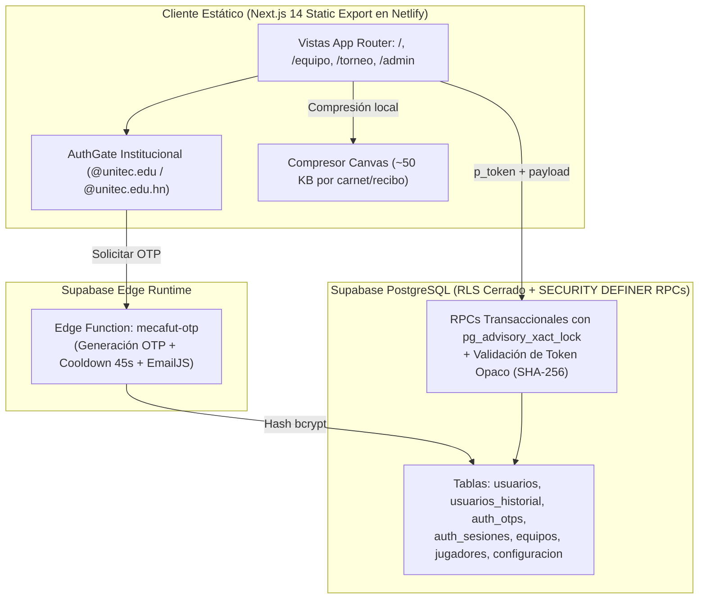

# 🚀 DEPLOYMENT_AI_GUIDE.md — Guía Técnica Integral de Arquitectura y Despliegue

> **ESTADO DE PRODUCCIÓN:** 🟢 **ACTIVO Y PUBLICADO**  
> **URL Oficial:** [https://mecafut-2026.netlify.app/](https://mecafut-2026.netlify.app/)  
> **Backend & Base de Datos:** Supabase PostgreSQL (`kqwcbhyevlftmgvbacln` / `us-east-1`) + Edge Function `mecafut-otp`  
> **Hosting & CI/CD:** Netlify (`output: "export"`) conectado a GitHub (`rama main`)  
> **Despacho de Correo OTP:** Supabase Edge Function `mecafut-otp` + EmailJS institucional (`@unitec.edu` / `@unitec.edu.hn`).

---

## 1. 🏗️ Arquitectura Real del Sistema



---

## 2. 🗄️ Modelo de Datos y Seguridad en PostgreSQL (`supabase/migrations/`)

El esquema se divide en dos migraciones coordinadas para despliegues sin caída de servicio (*zero-downtime*):

1. **[`2026110701_security_schema_and_rpcs.sql`](./supabase/migrations/2026110701_security_schema_and_rpcs.sql) (Fase 1 — Aditiva):**
   - Crea `public.auth_otps` (hashes `bcrypt`, expiración 10 min, máx. 5 intentos, cooldown 45s), `public.auth_sesiones` (tokens opacos almacenados como SHA-256 con TTL de 14 días y revocación en servidor) y `public.usuarios_historial` (bitácora inmutable de cambios de nombre, cuenta o DNI).
   - Añade columnas de control documental y soft-delete a `equipos` y `jugadores`: `estado_carnet` (`'pendiente' | 'en_revision' | 'verificado' | 'rechazado' | 'exento_docente'`), `verificado_por`, `verificado_en`, `motivo_rechazo`, `correo_verificado`, `dni_normalizado` e indicadores `eliminado`.
   - Instala todas las funciones RPC `SECURITY DEFINER` con `SET search_path = public, extensions`:
     - **Autenticación y Perfil:** `rpc_emitir_desafio_otp`, `rpc_registrar_otp_cliente`, `rpc_crear_cuenta_con_otp`, `rpc_login_con_password`, `rpc_login_con_otp`, `rpc_verificar_sesion`, `rpc_cerrar_sesion`, `rpc_obtener_perfil`, `rpc_guardar_perfil`.
     - **Flujos Públicos / Capitán / Jugador:** `rpc_obtener_resumen_publico`, `rpc_inscribir_equipo`, `rpc_buscar_equipo_por_codigo` (enmascara PII para no-capitanes), `rpc_agregar_jugador_con_codigo`, `rpc_expulsar_jugador`, `rpc_obtener_perfil_pendiente_jugador`, `rpc_actualizar_documento_jugador`, `rpc_subir_comprobante_equipo`.
     - **Administración (`/admin`):** `rpc_obtener_datos_admin`, `rpc_revisar_carnet_admin`, `rpc_verificar_carnets_equipo_admin`, `rpc_cambiar_estado_equipo_admin`, `rpc_eliminar_equipo_admin`, `rpc_cambiar_estado_inscripciones_admin`, `rpc_guardar_config_general_admin`, `rpc_guardar_estado_torneo_admin`.

2. **[`2026110702_lockdown_rls_policies.sql`](./supabase/migrations/2026110702_lockdown_rls_policies.sql) (Fase 2 — Cierre RLS Post-Deploy):**
   - Habilita `ROW LEVEL SECURITY` en todas las tablas y cierra el acceso directo `anon`/`authenticated` a `usuarios`, `usuarios_historial`, `auth_otps`, `auth_sesiones`, `equipos` y `jugadores`.
   - Mantiene lectura pública únicamente sobre las filas `'general'` y `'torneo'` de `public.configuracion` para permitir suscripciones Realtime seguras en `/torneo`.

---

## 3. ⚙️ Variables de Entorno

### En Netlify (`Site configuration > Environment variables`)
```bash
NEXT_PUBLIC_SUPABASE_URL=https://<project-ref>.supabase.co
NEXT_PUBLIC_SUPABASE_ANON_KEY=<publishable-anon-key>
NEXT_PUBLIC_EMAILJS_SERVICE_ID=<service_id>
NEXT_PUBLIC_EMAILJS_TEMPLATE_ID=<template_id>
NEXT_PUBLIC_EMAILJS_PUBLIC_KEY=<public_key>
NEXT_PUBLIC_ADMIN_EMAILS= # Opcional: correos adicionales separados por coma
```

### En Supabase Edge Function Secrets (`mecafut-otp`, Opcional Recomendado)
```bash
EMAILJS_SERVICE_ID=<service_id>
EMAILJS_TEMPLATE_ID=<template_id>
EMAILJS_PUBLIC_KEY=<public_key>
EMAILJS_PRIVATE_KEY=<access_token_privado_emailjs>
```

### Estado y diagnóstico del envío de OTP (2026-11-09)

- Los proveedores personales de Outlook/Gmail usados anteriormente como origen de envío no son adecuados para el envío transaccional del portal: Outlook bloqueó la cuenta tras muy pocos mensajes OTP. No depender de buzones personales ni crear cuentas paralelas como solución permanente.
- La Edge Function y el cliente alternan entre los servicios EmailJS `service_ar5incb` y `service_1cf52oc`. Ambos se configuraron en EmailJS para usar Mailjet; conservar esos IDs evita cambiar el código o desplegar Netlify solo por cambiar el proveedor conectado a un servicio existente. Si se cambia el ID que consume el código o sus variables de entorno, sí se requiere actualizar la configuración desplegada correspondiente.
- El test de plantilla de EmailJS respondió `200 OK`; el registro de Mailjet mostró dos mensajes OTP como `Delivered`, sin rebotes ni bloqueos. El usuario confirmó que los correos estaban en Spam/Correo no deseado. `Delivered` confirma aceptación por el servidor receptor, no llegada a la bandeja principal.
- La cuenta emisora observada usa una dirección Gmail sin dominio propio autenticado. Esto explica el riesgo de clasificación como spam y la configuración actual no garantiza llegada a Inbox. Siguiente mejora: usar un dominio controlado por el proyecto y autenticarlo en Mailjet con los registros DNS indicados por Mailjet (SPF y DKIM; configurar DMARC en el DNS del dominio), verificar el dominio y alinear el remitente `From` de la plantilla EmailJS con esa dirección. Mantener el `Reply-To` de contacto según corresponda.
- Para diagnosticar futuros fallos, revisar en orden el historial de EmailJS y el evento de Mailjet (Delivered, deferred/retrying, bounced o blocked), después Spam/Promociones del destinatario. No interpretar una respuesta HTTP 200 ni `Delivered` como prueba de lectura o de llegada a Inbox.
- La rotación entre servicios EmailJS no elimina límites ni bloqueos del proveedor por sí sola; Mailjet es el origen transaccional actual configurado, sujeto a sus límites y políticas. No guardar claves SMTP/API, claves privadas, OTP ni direcciones personales en esta documentación.

---

## 4. 🏆 Reglas Operativas del Torneo

- **Categoría Masculina:** Cupo máximo de **12 equipos** (Eliminación directa con 4 `BYE` a Cuartos de Final + 4 partidos preliminares).
- **Categoría Femenina:** Cupo máximo de **4 equipos** con formato dual en `/admin`:
  - **3 equipos aptos:** Triangular Todos contra Todos (3 jornadas) + Gran Final automática (1° vs 2°).
  - **4 equipos aptos:** Semifinales + Gran Final.
- **Elegibilidad para Llaves (`esEquipoAptoParaLlaves`):** Pago en estado `Confirmado` + mínimo **8 integrantes** con `estado_carnet` en `'verificado'` o `'exento_docente'`.
- **Cascada de Resultados:** Si un Administrador corrige el ganador de una ronda previa en Eliminación Directa o cambia las clasificadas del Triangular, el sistema advierte antes de guardar y limpia automáticamente los encuentros dependientes posteriores para impedir llaves incoherentes.

---

## 5. 🧪 Checklist de Verificación Pre y Post-Despliegue

1. **Suite Automatizada Completa:** Ejecutar `node tests/e2e/runner.mjs` (178 pruebas E2E en Tiers 1–5).
2. **Build Estático y Escaneo de Seguridad:** Ejecutar `npm run build` y comprobar que `out/_next/static/` no contenga comodines de desarrollo (`123456`).
3. **Reglamento y Alerta de Soporte:** Verificar en modo incógnito el modal reglamentario (scroll + 5s) y el botón de reporte a WhatsApp (`+504 9474-4365`).
4. **Enmascaramiento en `/equipo`:** Consultar un código de equipo con un estudiante externo y confirmar que DNI, correos, carnets y comprobantes aparezcan protegidos.
5. **Panel `/admin`:** Verificar insignia oficial `Servidor Cloud Activo (Supabase + RLS)`, verificación en lote de carnets en 1 clic, alertas de cambio de identidad y exportación a Excel/PDF.
