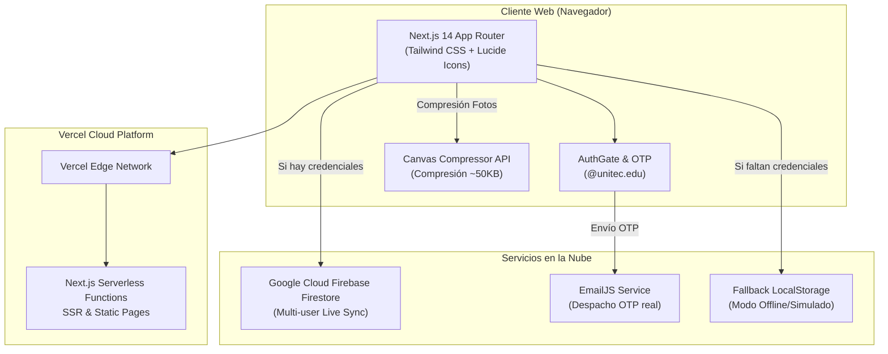

# 🚀 DEPLOYMENT_AI_GUIDE.md — Guía Técnica Integral de Despliegue en la Nube

> **ESTADO DE PRODUCCIÓN:** 🟢 **ACTIVO Y PUBLICADO**  
> **URL Oficial:** [https://mecafut-2026.netlify.app/](https://mecafut-2026.netlify.app/)  
> **Backend & Base de Datos:** Supabase PostgreSQL (`mecafut-2026` / `us-east-1`)  
> **Hosting & CI/CD:** Netlify (`mecafut-2026.netlify.app`) conectado a GitHub `PaladinDiego/Mecafut` (rama `main`)  
> **Servicio de Correo OTP:** EmailJS (`mecatronica.unitec@outlook.com`) con firma oficial de Carlos Rubi.

---

## 1. 🏗️ Arquitectura del Sistema



---

## 2. 🗄️ Esquema de Base de Datos (Firebase Firestore)

Firestore opera como una base de datos de documentos NoSQL. La aplicación gestiona las siguientes colecciones principales:

### Colección: `equipos`
- **ID de documento:** Auto-generado por Firestore o código único de equipo (ej. `MCF-8492`).
- **Campos:**
  ```typescript
  {
    codigo: string;              // Código único de 6 a 8 caracteres (ej. "TIGRES-26")
    nombre: string;              // Nombre del equipo
    categoria: "Masculino" | "Femenino";
    carrera: string;             // Ingeniería Mecatrónica u otra
    capitan: {
      nombre: string;
      correo: string;            // Debe terminar en @unitec.edu o @unitec.edu.hn
      telefono: string;
      cuenta: string;            // Número de cuenta institucional (8 dígitos)
      dni: string;               // Documento Nacional de Identificación
      fotoCarnet?: string;       // Base64 comprimido o URL de imagen
    };
    integrantes: Array<{
      id: string;
      nombre: string;
      correo: string;
      cuenta: string;
      dni: string;
      esDocente?: boolean;
      fotoCarnet?: string;       // Base64 comprimido (~50 KB)
    }>;
    pago: {
      estado: "pendiente" | "aprobado" | "rechazado";
      monto: number;             // Cuota de inscripción oficial
      referencia: string;
      comprobanteUrl?: string;   // Base64 comprimido del recibo
      validadoPor?: string;      // Correo del administrador que aprobó
      fechaValidacion?: string;
    };
    creadoEn: string;            // ISO Timestamp
    actualizadoEn: string;
  }
  ```

### Colección: `configuracion`
- **ID de documento:** `torneo`
- **Campos:**
  ```typescript
  {
    inscripcionesAbiertas: boolean;
    cupoMasculino: number;       // Defecto: 12
    cupoFemenino: number;        // Defecto: 3
    fechaCierreInscripcion: string;
    fechaInicioTorneo: string;
    mostrarResultadosPublicos: boolean; // Se activa automáticamente el día del torneo o manualmente por el admin
    llavesMasculino?: {
      octavos: Array<any>;
      cuartos: Array<any>;
      semifinales: Array<any>;
      final: any;
    };
    triangularFemenino?: {
      partidos: Array<{
        id: string;
        equipoA: string;
        equipoB: string;
        golesA: number;
        golesB: number;
        jugado: boolean;
      }>;
      tablaPosiciones: Array<any>;
      granFinal: any;
    };
    premiosDinamicos?: Array<{
      id: string;
      nombre: string;           // Ej: "Portero con más goles tapados", "Máximo Goleador"
      jugadorGanador?: string;
      conteo?: number;
    }>;
  }
  ```

---

## 3. 📧 Configuración de Correo Real (EmailJS)

Para que los códigos de verificación OTP lleguen directamente al buzón Outlook/Office 365 institucional de los estudiantes de UNITEC:

1. Crea una cuenta gratuita en [EmailJS](https://www.emailjs.com/) (permite hasta 200 correos gratis al mes).
2. En **Email Services**, conecta un servicio de correo (Gmail, Outlook o SMTP) y copia el `SERVICE_ID`.
3. En **Email Templates**, crea una plantilla con los siguientes parámetros requeridos por la aplicación:
   - **Asunto:** `Código de verificación MECAFUT 2026: {{codigo_otp}}`
   - **Contenido del correo:**
     ```html
     <h2>¡Hola, {{nombre_usuario}}!</h2>
     <p>Tu código de verificación para ingresar a la plataforma de MECAFUT 2026 es:</p>
     <h1 style="color: #002B49; font-size: 32px; letter-spacing: 5px;">{{codigo_otp}}</h1>
     <p>Este código expira en 10 minutos. No lo compartas con nadie.</p>
     <p>Comité Organizador — Facultad de Ingeniería Mecatrónica, UNITEC Honduras</p>
     ```
   - **To Email:** `{{to_email}}`
4. Copia el `TEMPLATE_ID` y tu `PUBLIC_KEY` (disponible en **Account > API Keys**).
5. Define las 3 variables de entorno en Vercel:
   ```bash
   NEXT_PUBLIC_EMAILJS_SERVICE_ID=service_xxxxxxx
   NEXT_PUBLIC_EMAILJS_TEMPLATE_ID=template_xxxxxxx
   NEXT_PUBLIC_EMAILJS_PUBLIC_KEY=xxxxxxxxxxxxxxxxxxxx
   ```

---

## 4. 🚢 Despliegue en Vercel Paso a Paso

### Método 1: Despliegue Directo desde GitHub (Recomendado)
1. El usuario debe ingresar a [Vercel Dashboard](https://vercel.com/new).
2. Seleccionar el repositorio `PaladinDiego/Mecafut`.
3. Dejar el Framework Preset en **Next.js**.
4. Desplegar la sección **Environment Variables** y pegar todas las variables de `.env.example`:
   * `NEXT_PUBLIC_FIREBASE_API_KEY`
   * `NEXT_PUBLIC_FIREBASE_AUTH_DOMAIN`
   * `NEXT_PUBLIC_FIREBASE_PROJECT_ID`
   * `NEXT_PUBLIC_FIREBASE_STORAGE_BUCKET`
   * `NEXT_PUBLIC_FIREBASE_MESSAGING_SENDER_ID`
   * `NEXT_PUBLIC_FIREBASE_APP_ID`
   * (Opcional) Variables de EmailJS y `NEXT_PUBLIC_ADMIN_EMAILS`.
5. Hacer clic en **Deploy**.

### Método 2: Despliegue Mediante Vercel CLI
Si el usuario o la IA tienen acceso a la CLI de Vercel en la terminal:
```bash
# 1. Vincular proyecto
npx vercel link

# 2. Subir variables de entorno
npx vercel env add NEXT_PUBLIC_FIREBASE_API_KEY production
# (repetir para las demás variables)

# 3. Compilar y desplegar a producción
npx vercel --prod
```

---

## 5. 🛡️ Lista Blanca y Permisos del Comité Administrador

Los siguientes 11 correos institucionales están blindados a nivel de código (`lib/torneoConfig.js`) y de base de datos (`firestore.rules`):

| Correo Institucional | Cargo / Rol Asignado | Tipo | Privilegios Especiales |
|---|---|---|---|
| `andresvalle@unitec.edu` | Comité Organizador | Estudiante | Acceso total `/admin` y resultados |
| `carlos.rubi@unitec.edu` | Comité Organizador | Estudiante | Acceso total `/admin` y resultados |
| `juan.mejia@unitec.edu.hn` | Comité / Ing. Juan Miguel Mejía | **Docente** | **Dual:** Admin total + Exento carnet + Multiequipo |
| `Cristhyan.Rivera@unitec.edu.hn` | Comité / Ing. Cristhyan Rivera | **Docente** | **Dual:** Admin total + Exento carnet + Multiequipo |
| `joserodasgodoy@unitec.edu` | Comité Organizador | Estudiante | Acceso total `/admin` y resultados |
| `c.marcelo.al@unitec.edu` | Comité Organizador | Estudiante | Acceso total `/admin` y resultados |
| `cesar_lopez@unitec.edu` | Comité Organizador | Estudiante | Acceso total `/admin` y resultados |
| `adioyuela@unitec.edu` | Comité Organizador | Estudiante | Acceso total `/admin` y resultados |
| `maria_giron@unitec.edu` | Comité Organizador | Estudiante | Acceso total `/admin` y resultados |
| `dereck.beltrand@unitec.edu` | Comité Organizador | Estudiante | Acceso total `/admin` y resultados |
| `jalfaro@unitec.edu` | Comité Organizador | Estudiante | Acceso total `/admin` y resultados |

Si se requiere habilitar a alguien más temporalmente o de forma permanente, **no es necesario recompilar**: simplemente agrega la variable en Vercel:
```bash
NEXT_PUBLIC_ADMIN_EMAILS=nuevo_organizador@unitec.edu,asistente@unitec.edu.hn
```

---

## 6. 🧪 Protocolo de Verificación Funcional (Smoke Tests)

Ejecuta este checklist una vez que el despliegue esté en línea:

- [ ] **Modal de Reglamento:** Visitar la raíz (`/`). Verificar que el modal bloquee la pantalla, requiera scroll completo y espere 5 segundos antes de permitir la confirmación.
- [ ] **Autenticación Estudiante:** Intentar iniciar sesión con un correo no institucional (ej: `prueba@gmail.com`) y verificar que sea rechazado con mensaje amigable.
- [ ] **Autenticación Admin:** Iniciar sesión con `carlos.rubi@unitec.edu`. Verificar que la barra de navegación muestre `👑 ADMIN` y el enlace a `/admin`.
- [ ] **Padrón de Jugadores:** Entrar a `/admin > Padrón`. Verificar que los equipos se muestren agrupados por defecto con conteo de integrantes y botón `🪪 Ver Carnet`.
- [ ] **Generador de Llaves:** Entrar a `/admin > Llaves del Torneo`. Probar el botón `🎲 Sorteo Aleatorio` tanto en la categoría Masculina (12 equipos) como en la Femenina (Triangular 3 equipos).
- [ ] **Marcador en Vivo:** En `/admin > Torneo en Vivo`, registrar un gol con un goleador específico y verificar que el marcador se actualice.
- [ ] **Exportación:** Probar los botones de descarga de **Planilla PDF** y **Padrón Excel (.xlsx)** para confirmar que se generen correctamente en el navegador.
